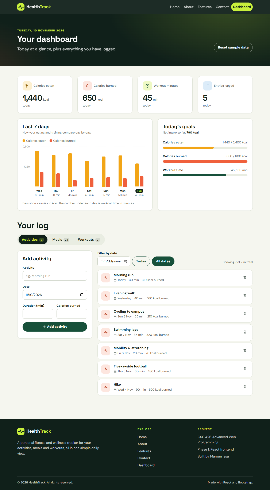

# HealthTrack

HealthTrack is a personal fitness and wellness tracker. It lets you log your **activities**, **meals** and **workouts**, and turns them into a daily summary and a 7-day progress view.

This repository is **Phase 1** of the CSCI426 Advanced Web Programming project: a complete React frontend. Phase 2 will add a backend and a database to the same app.

- **Developer:** Maroun Issa
- **Course:** CSCI426 Advanced Web Programming
- **Live demo:** _add your Vercel URL here_

## Features

- Five pages plus a 404 page, each on its own route, with a shared navbar and footer
- Dashboard with three trackers (Activities, Meals, Workouts) in tabs
  - Add form with inline validation, list of entries, delete per entry, filter by date
  - Summary cards: calories eaten, calories burned, workout minutes and entries logged today
  - 7-day progress chart built with plain `div`s and CSS (no chart library)
  - Daily goal progress bars and empty states
- Contact form with client-side validation and a success state
- Fully responsive (phone, tablet, desktop) with a mobile hamburger menu
- Custom visual identity on top of Bootstrap, defined in one stylesheet
- Data saved in the browser (`localStorage`), with sample data on first load

## Tech stack

| Tool | Used for |
| --- | --- |
| [React 19](https://react.dev/) (JavaScript) | Components and state |
| [Vite](https://vite.dev/) | Dev server and production build |
| [React Router](https://reactrouter.com/) | Client-side routing |
| [Bootstrap 5](https://getbootstrap.com/) + [react-bootstrap](https://react-bootstrap.github.io/) | Grid and UI components |
| Custom CSS (`src/styles/theme.css`) | Colours, fonts, spacing and custom components |
| `localStorage` | Data storage for Phase 1 |
| ESLint | Code quality |

No UI template or paid kit is used. All pages and components are written from scratch.

## Getting started

You need [Node.js](https://nodejs.org/) 20 or newer.

```bash
# 1. Clone the repository
git clone https://github.com/<your-username>/healthtrack.git
cd healthtrack

# 2. Install dependencies
npm install

# 3. Start the development server
npm run dev
```

Then open the address shown in the terminal (usually http://localhost:5173).

### Other commands

| Command | What it does |
| --- | --- |
| `npm run build` | Creates the production build in `dist/` |
| `npm run preview` | Serves the production build locally |
| `npm run lint` | Checks the code with ESLint |

## Project structure

```
src/
├── main.jsx              Entry point: Bootstrap CSS, theme, router
├── App.jsx               Route table
├── pages/                One file per route
│   ├── Home.jsx
│   ├── About.jsx
│   ├── Features.jsx
│   ├── Contact.jsx
│   ├── Dashboard.jsx
│   └── NotFound.jsx
├── components/           Reusable pieces
│   ├── Layout.jsx        Navbar + page + footer
│   ├── AppNavbar.jsx, Footer.jsx, Brand.jsx
│   ├── PageHeader.jsx, FeatureCard.jsx, Icon.jsx
│   ├── StatCard.jsx, GoalProgress.jsx, WeeklyChart.jsx
│   └── TrackerPanel.jsx, EntryForm.jsx, EntryList.jsx,
│       DateFilter.jsx, EmptyState.jsx
├── services/
│   └── storage.js        The only file that reads or writes data
├── data/
│   ├── entryTypes.js     Field configuration for the three trackers
│   ├── seedData.js       Sample data for the first load
│   └── navLinks.js       Navigation links
├── utils/
│   ├── date.js           Date helpers
│   └── stats.js          Totals for the summary cards and chart
└── styles/
    └── theme.css         Design tokens and Bootstrap overrides
```

## Data and Phase 2

All data access goes through `src/services/storage.js`:

```js
getEntries(type)        // 'activities' | 'meals' | 'workouts'
addEntry(type, entry)
deleteEntry(type, id)
```

These functions use `localStorage` today but already return Promises. In Phase 2 only this file changes: each function body becomes a `fetch()` call to the backend API, and the components stay the same.

To start again with the sample data, use the **Reset sample data** button on the dashboard.

## Deployment (Vercel)

The project includes a `vercel.json` that rewrites every path to `index.html`, so routes such as `/dashboard` still work after a page refresh.

1. Push the repository to GitHub.
2. On [vercel.com](https://vercel.com/), choose **Add New > Project** and import the repository.
3. Keep the detected settings (Framework: Vite, build command `npm run build`, output `dist`) and click **Deploy**.

## Screenshots

> Replace the placeholders below with real screenshots saved in `docs/screenshots/`.

| Page | Desktop (1280px) | Mobile (375px) |
| --- | --- | --- |
| Home | `docs/screenshots/home-desktop.png` | `docs/screenshots/home-mobile.png` |
| About | `docs/screenshots/about-desktop.png` | `docs/screenshots/about-mobile.png` |
| Features | `docs/screenshots/features-desktop.png` | `docs/screenshots/features-mobile.png` |
| Contact | `docs/screenshots/contact-desktop.png` | `docs/screenshots/contact-mobile.png` |
| Dashboard | `docs/screenshots/dashboard-desktop.png` | `docs/screenshots/dashboard-mobile.png` |
| 404 | `docs/screenshots/404-desktop.png` | `docs/screenshots/404-mobile.png` |

<!-- Example once the image exists:

-->

## Author

Maroun Issa, CSCI426 Advanced Web Programming.
